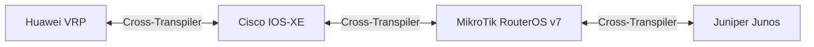

# MULTI-VENDOR MATRIX & DRIVER SPECIFICATION
> Kompatibilitas Hardware, Driver CLI/API, dan Mapping Sintaks Antar-Vendor.

---

## 1. Tabel Kompatibilitas Vendor

| Vendor | Sistem Operasi | Protokol Akses | Port Default | Driver Class di Monorepo |
| :--- | :--- | :--- | :---: | :--- |
| **MikroTik** | RouterOS v7.12+ (v7.15 Recommended) | REST API / API-SSL / SSH | 443 / 8728 / 22 | `RosApiConnector` (`@audira/routeros`) |
| **Cisco Systems** | Cisco IOS & IOS-XE (Catalyst, ASR, ISR) | SSH2 CLI Streaming | 22 | `CiscoIOSConnector` (`@audira/ssh`) |
| **Huawei** | Huawei VRP (CloudEngine, S-Series, NE) | SSH2 CLI Streaming | 22 | `HuaweiVRPConnector` (`@audira/ssh`) |
| **Juniper** | Junos OS (MX, EX, SRX Series) | SSH2 Candidate Commit | 22 | `JuniperJunosConnector` (`@audira/ssh`) |
| **Linux / Generic** | Ubuntu Server, Debian, VyOS, Alpine | SSH2 PTY Streamer | 22 | `LinuxServerConnector` (`@audira/ssh`) |

---

## 2. Karakteristik & Dialek Perintah

### 2.1 MikroTik RouterOS v7
- **Format File**: `.rsc`
- **Model Eksekusi**: Direct Apply dengan dukungan safe-mode (`Ctrl+X`).
- **Spesifikasi Unik v7**:
  - Routing Filters menggunakan syntax scripting baru:  
    `/routing/filter/rule add chain=bgp-in rule="if (dst in 10.0.0.0/8) { accept; } else { reject; }"`
  - BGP peer dikonfigurasi melalui hierarki template:  
    `/routing/bgp/template` dan `/routing/bgp/connection`.

### 2.2 Cisco IOS & IOS-XE
- **Format File**: `.cfg`
- **Model Eksekusi**: Config Mode (`configure terminal`) -> Commit via `end` & `write memory`.
- **Driver PTY Parser**: Menangani paging `--More--` dengan auto-sending spasi atau `terminal length 0`.

### 2.3 Huawei VRP
- **Format File**: `.cfg`
- **Model Eksekusi**: View-based (`system-view`) -> Commit model (`commit` pada seri VRP8 / CloudEngine, atau auto-apply pada switch legacy).
- **Prompt Detection**: Mendeteksi prompt `<Huawei>` dan `[Huawei]`.

### 2.4 Juniper Junos OS
- **Format File**: `.conf`
- **Model Eksekusi**: Candidate-Commit Model (`configure` -> candidate edits -> `commit check` -> `commit confirmed 5`).
- **Safety**: Fitur `commit confirmed` membatalkan perubahan secara otomatis dalam 5 menit jika konektivitas terputus.

---

## 3. Cross-Vendor Transpiler Mapping

Engine transpiler pada [`ConfigManager.tsx`](file:///f:/AUDIRA-NetOps-AI/apps/web/src/components/config/ConfigManager.tsx) mampu memetakan konfigurasi umum antar platform secara otomatis:

### Contoh Pemetaan:
1. **Interface IP Assignment**:
   - *Cisco*: `interface GigabitEthernet0/1` -> `ip address 192.168.10.1 255.255.255.0`
   - *MikroTik*: `/ip address add address=192.168.10.1/24 interface=ether1`
   - *Huawei*: `interface GigabitEthernet0/0/1` -> `ip address 192.168.10.1 24`
   - *Juniper*: `set interfaces ge-0/0/0 unit 0 family inet address 192.168.10.1/24`

2. **Static Route**:
   - *Cisco*: `ip route 10.0.0.0 255.0.0.0 192.168.1.1`
   - *MikroTik*: `/ip route add dst-address=10.0.0.0/8 gateway=192.168.1.1`
   - *Huawei*: `ip route-static 10.0.0.0 8 192.168.1.1`
   - *Juniper*: `set routing-options static route 10.0.0.0/8 next-hop 192.168.1.1`
