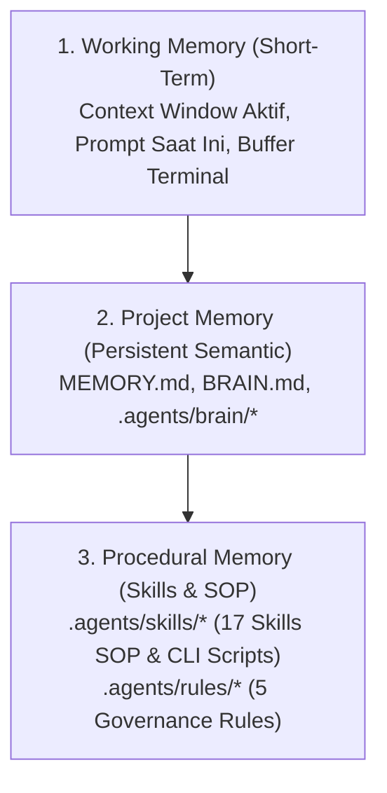

# MEMORY.md — Living Long-Term Memory & System Recall

> **Filosofi Inti**:  
> *"AI tanpa memori adalah asisten yang amnesia setiap kali sesi berganti. Memori persisten adalah jangkar yang memastikan setiap keputusan teknis, arsitektur, dan keamanan tetap konsisten, akurat, dan terus berkembang tanpa regresi."*

---

## 1. Apa Itu Memory dan Mengapa Proyek Membutuhkannya?

Secara alami, Large Language Model (LLM) dan AI Coding Agent bersifat **stateless** — setiap percakapan baru dimulai dengan jendela konteks kosong. Tanpa memori tertulis, AI akan:
1. **Mengalami Amnesia Arsitektur**: Lupa stack teknologi, skema database, konvensi penamaan, dan struktur folder.
2. **Membuat Duplikasi & Konflik Kode**: Mengimplementasikan ulang modul yang sebenarnya sudah ada, atau menulis ulang kode dengan pola yang bertabrakan.
3. **Menghalunisasikan State Proyek**: Mengasumsikan fitur belum ada padahal sudah selesai, atau sebaliknya.
4. **Melanggar Guardrails Keamanan**: Lupa aturan ketat seperti larangan mengekspos kredensial, aturan approval, atau kebijakan change-freeze.

**`MEMORY.md` dan ekosistem [`.agents/brain/`](file:///f:/AUDIRA-NetOps-AI/.agents/brain)** bertindak sebagai **hippocampus** (pusat ingatan jangka panjang) proyek ini.

---

## 2. Lima Fungsi Utama Memory dalam Proyek

```
┌────────────────────────────────────────────────────────────────────────┐
│                        FUNGSI MEMORY SISTEM                            │
├───────────────────┬────────────────────────────────────────────────────┤
│ 1. Anti-Amnesia   │ Mengingat visi produk, dependensi, dan arsitektur  │
│ 2. Anti-Redundansi│ Mencegah duplikasi file, fungsi, dan tabel DB      │
│ 3. Governance     │ Memastikan aturan keamanan & safety selalu dipatuhi│
│ 4. Evolution Track│ Mencatat apa yang sudah rilis vs roadmap depan     │
│ 5. Multi-Agent Hub│ Sinkronisasi konteks antar sesi dan subagent       │
└───────────────────┴────────────────────────────────────────────────────┘
```

### A. Preservasi Arsitektur (Anti-Amnesia)
Setiap sesi baru langsung mengetahui:
- Monorepo Turborepo 15 packages/apps dengan Strict TypeScript.
- Pembagian layer: `apps/web` (UI), `apps/api` (REST & WS), `packages/ai-agent` (Copilot & Tools), `packages/security` (Kriptografi & Risk Engine), dll.

### B. Mencegah Pemborosan & Konflik (Anti-Redundansi)
Sebelum membuat file atau fungsi baru, agent dapat memeriksa memory katalog fitur untuk memastikan modul tersebut belum pernah dibuat sebelumnya.

### C. Penjaga Tata Kelola & Keamanan (Governance & Safety)
Memory menjamin agent tidak akan pernah melanggar:
- **Zero Credential Leaks**: Kredensial tidak boleh diekspos ke frontend atau log mentah.
- **9-Step AI Execution Safety Pipeline**: Setiap mutasi jaringan wajib divalidasi, di-snapshot, dan melalui approval gate.
- **Strict TypeScript**: Tidak ada toleransi untuk penggunaan tipe `any`.

### D. Pelacak Riwayat & Arah Masa Depan (Evolution Tracker)
Mencatat dengan presisi versi apa yang sudah aktif di lingkungan produksi dan fitur apa yang masih berstatus rencana (roadmap).

### E. Sinkronisasi Antar Sesi (Persistent Cross-Session Bridge)
Memungkinkan perpindahan operator, restart sistem, atau pergantian model AI tanpa kehilangan kemajuan yang telah dicapai pada sesi sebelumnya.

---

## 3. Tiga Tingkatan Hierarki Memori



1. **Working Memory (Jangka Pendek / Sesi)**:
   - Berisi prompt percakapan aktif dan hasil tool call terkini.
   - Terhapus otomatis saat sesi ditutup atau jendela konteks direset.
2. **Project Memory (Jangka Panjang / Semantic Brain)**:
   - Disimpan persisten di [`MEMORY.md`](file:///f:/AUDIRA-NetOps-AI/MEMORY.md), [`BRAIN.md`](file:///f:/AUDIRA-NetOps-AI/BRAIN.md), dan folder [`.agents/brain/`](file:///f:/AUDIRA-NetOps-AI/.agents/brain).
   - Menjadi acuan kebenaran (*Single Source of Truth*) arsitektur sistem.
3. **Procedural Memory (Panduan Prosedural / Execution SOP)**:
   - Disimpan di [`.agents/skills/`](file:///f:/AUDIRA-NetOps-AI/.agents/skills) (17 Standard Operating Procedures) dan [`.agents/rules/`](file:///f:/AUDIRA-NetOps-AI/.agents/rules) (5 Kebijakan Tata Kelola).
   - Menjelaskan *bagaimana* cara mengeksekusi triage BGP, audit CIS benchmark, optimasi QoS, mitigasi DDoS, dll.

---

## 4. Empat Aturan Emas Menggunakan Memory (The 4 Golden Rules)

Setiap AI Agent, pair programmer, atau pengembang yang bekerja di proyek ini **WAJIB** menerapkan 4 langkah:

### 1. BACA TERLEBIH DAHULU (Read Before Acting)
Sebelum mengubah baris kode atau merancang fitur baru, **baca dokumen memory terkait** untuk memahami fondasi yang sudah ada.

### 2. VERIFIKASI DENGAN KODE AKTIF (Verify Against Reality)
Memory adalah representasi struktural. Selalu cocokkan apa yang tertulis di memory dengan file sumber aktif (`packages/`, `apps/`) sebelum melakukan modifikasi.

### 3. PERBARUI SETIAP ADA PERUBAHAN (Update on Every Mutation)
Sesuai protokol [`.agents/rules/brain-sync-protocol.md`](file:///f:/AUDIRA-NetOps-AI/.agents/rules/brain-sync-protocol.md), setiap penambahan fitur, library, rute, tabel, atau driver vendor **WAJIB langsung dicatat** ke dokumen memory terkait sebelum mengakhiri sesi.

### 4. JAGA KEBERSIHAN & KONTINUITAS (Prune & Keep Evergreen)
Hapus catatan yang sudah kedaluwarsa atau tandai status fitur yang telah selesai dibangun agar memory tidak menjadi arsip mati, melainkan sistem hidup yang selalu segar (*living document*).

---

## 5. Peta Indeks Memori Cepat (AUDIRA NetOps AI Memory Directory)

| File Dokumen Memory | Topik Utama yang Diingat |
| :--- | :--- |
| **[`MEMORY.md`](file:///f:/AUDIRA-NetOps-AI/MEMORY.md)** *(File Ini)* | **Panduan Filosofi & Cara Kerja Memori Jangka Panjang Proyek** |
| **[`BRAIN.md`](file:///f:/AUDIRA-NetOps-AI/BRAIN.md)** | Master Portal & Direktori Seluruh Dokumen Pengetahuan Sistem |
| **[`SYSTEM_ARCHITECTURE.md`](file:///f:/AUDIRA-NetOps-AI/.agents/brain/SYSTEM_ARCHITECTURE.md)** | Struktur 15 Packages/Apps, Monorepo Turborepo, dan Container Docker |
| **[`FEATURE_CATALOG.md`](file:///f:/AUDIRA-NetOps-AI/.agents/brain/FEATURE_CATALOG.md)** | Katalog Lengkap 24+ Modul NOC, Lokasi File Komponen, dan Fungsinya |
| **[`SECURITY_AND_GOVERNANCE.md`](file:///f:/AUDIRA-NetOps-AI/.agents/brain/SECURITY_AND_GOVERNANCE.md)** | 9-Step AI Safety Pipeline, Risk Matrix, Four-Eyes Quorum, Break-Glass |
| **[`MULTI_VENDOR_MATRIX.md`](file:///f:/AUDIRA-NetOps-AI/.agents/brain/MULTI_VENDOR_MATRIX.md)** | Driver MikroTik RouterOS v7, Cisco IOS-XE, Huawei VRP, Juniper Junos |
| **[`DATABASE_AND_DATA_FLOW.md`](file:///f:/AUDIRA-NetOps-AI/.agents/brain/DATABASE_AND_DATA_FLOW.md)** | Skema 23 Tabel PostgreSQL, Redis Pub/Sub, dan Zustand Store Client |
| **[`UPDATE_HISTORY_AND_ROADMAP.md`](file:///f:/AUDIRA-NetOps-AI/.agents/brain/UPDATE_HISTORY_AND_ROADMAP.md)** | Catatan Riwayat Versi (v1.0.0, v1.1.0) dan Roadmap Pengembangan Masa Depan |
| **[`.agents/mcp_config.json`](file:///f:/AUDIRA-NetOps-AI/.agents/mcp_config.json)** | Konfigurasi Model Context Protocol Server (RouterOS Gateway & Diag) |
| **[`.agents/skills/`](file:///f:/AUDIRA-NetOps-AI/.agents/skills)** | 17 Standar Operasional Prosedur (SOP) Teknis Jaringan & Skrip CLI |
| **[`.agents/rules/`](file:///f:/AUDIRA-NetOps-AI/.agents/rules)** | 5 Kebijakan Formal Kepatuhan, Keamanan, dan Sinkronisasi Brain |

---

> **Motto Sistem**: *"Kode yang hebat ditulis oleh engineer yang teliti. Sistem yang abadi dijaga oleh memori yang tidak pernah lupa."*
